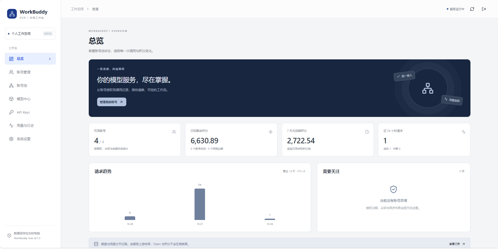
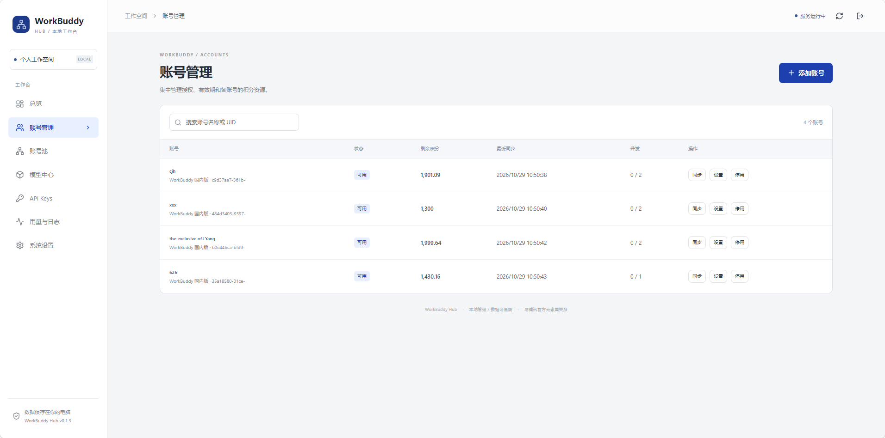
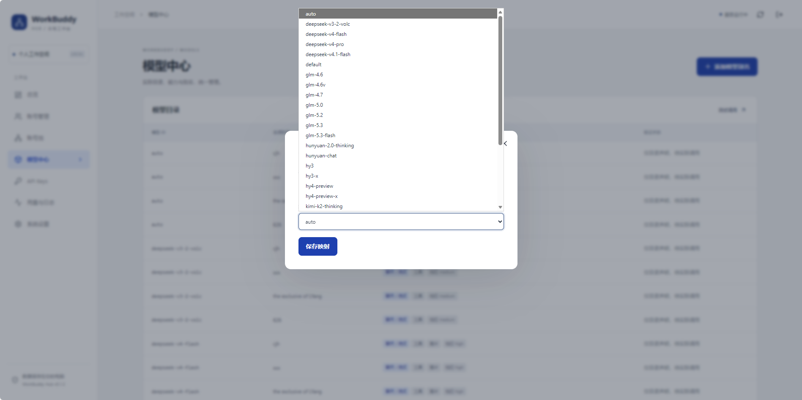
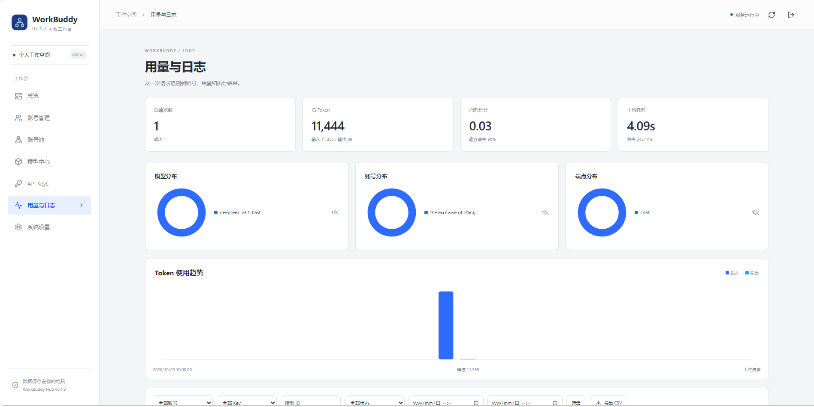
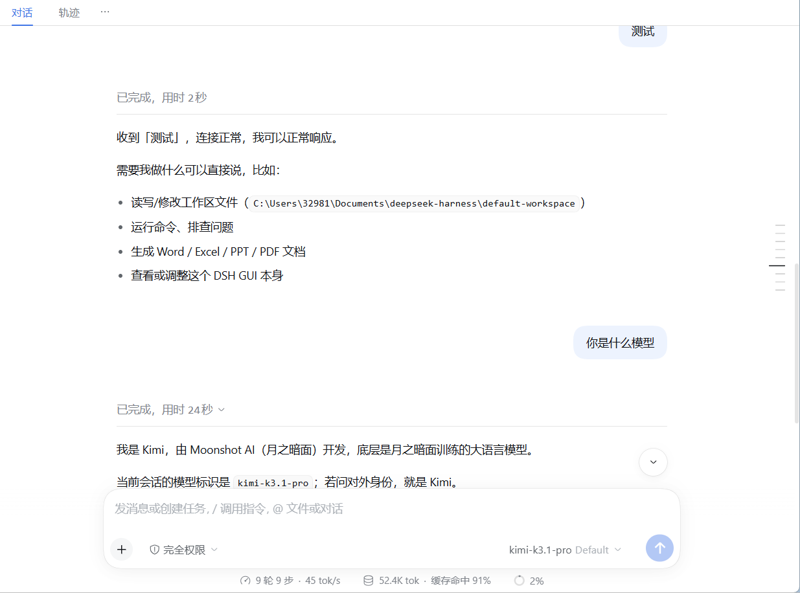

<div align="center">

# WorkBuddy Hub

**WorkBuddy 国内版本地 API 网关与管理台**

账号 · 额度 · API Key · 用量日志，一个进程全部搞定。


[快速开始](#快速开始) · [核心特性](#核心特性) · [API 边界](#api-能力边界) · [安全与备份](#安全与备份) · [跨机访问](#跨机访问)

</div>

---

## 项目简介

WorkBuddy Hub 是一个 **Windows 本地运行**的 WorkBuddy 国内版账号、API、额度与日志管理系统。独立后端与 React 管理台由同一个程序托管，**不需要另行启动 Switch2api 或 wb2api**。

它把官方授权、账号池调度、OpenAI / Anthropic 兼容网关、用量账本和管理界面收在同一个进程里：

- 默认只监听回环地址，数据留在本机；
- 扫码只在官方授权页面进行，不批量注册、不生成或伪造设备身份、不修改 WorkBuddy 客户端文件；
- 不保存聊天正文、工具参数、密码或令牌到日志。

> [!IMPORTANT]
> 本项目与腾讯官方无隶属关系。请仅用于管理你本人有权使用的账号，并遵守 WorkBuddy 的服务条款。

当前版本 **0.1.3**。版本变更见 [CHANGES.md](CHANGES.md)；0.1.1 的外部审查逐项核验与不采纳理由见 [REVIEW-RESPONSE.md](REVIEW-RESPONSE.md)。

## 界面预览

<p align="center">
  
</p>

<p align="center"><em>总览：账号状态、剩余积分、请求趋势与异常提醒</em></p>

| 账号管理 | 模型中心 |
|:---:|:---:|
|  |  |
| 集中查看授权状态、剩余积分与账号并发 | 查看可用模型并配置模型映射 |

| 用量与日志 | 对话测试 |
|:---:|:---:|
|  |  |
| Token、积分、模型与端点分布 | 确认 API 连接与模型响应正常 |

## 核心特性

| 模块 | 能力 |
|---|---|
| **账号与授权** | 官方扫码授权、已有授权导入、令牌刷新、模型能力目录、余额与积分包查询、新旧账单接口兼容 |
| **账号池** | 均衡 / 临期调度、显式备用池、会话绑定、账号冷却、账号级并发 |
| **兼容网关** | OpenAI Chat Completions、OpenAI Responses、Anthropic Messages；流式与非流式 |
| **Key 与预算** | 独立 API Key、模型范围、有效期、RPM、请求预算、Key 级并发、单独吊销 |
| **运营与观测** | 总览、用量账本、筛选日志与 CSV、调用测试、任务与审计、配置与备份 |
| **本地与安全** | 回环监听、DPAPI 加密、CSRF / Origin / Host 校验、加密备份、单实例锁、桌面托盘 |
| **交付形态** | 源码运行、独立 EXE、可重复的测试与打包脚本 |

## 快速开始

### 一键启动（推荐）

在当前项目双击 **`start.bat`**：

- 存在 Python 虚拟环境时以**源码**方式启动（开发目录的默认行为）；
- 没有虚拟环境时回退到 `dist\WorkBuddyHub.exe`；
- 两种方式都使用本项目 `data/` 目录，保留已经授权的账号。

启动后：

| 项目 | 地址 / 位置 |
|---|---|
| 管理台 | <http://127.0.0.1:8792> |
| API 基址 | `http://127.0.0.1:8792/v1` |
| 首次管理员密码 | 数据目录中的 `initial-admin.txt`（正常启动会打开），登录后可在系统设置修改 |
| 数据目录 | 源码运行默认 `data/`；直接运行 EXE 默认 `%LOCALAPPDATA%/WorkBuddyHub` |

几点行为说明：

- 控制台窗口会保持打开并显示管理台地址；关闭窗口或按 `Ctrl+C` 即停止服务。
- 若服务已在运行，脚本只打开管理台，不会再起第二个实例。
- 启动失败时窗口不会闪退（`start.bat` 会 `pause`），可以直接看到错误信息。
- `start.bat` 会转发参数，例如 `start.bat --port 8800`、`start.bat -NoBrowser`。

### 常用参数

| 参数 | 作用 |
|---|---|
| `--data-dir` | 指定已有数据目录；目录内有实例锁，避免两个进程同时维护同一套凭据 |
| `--port` | 修改监听端口（默认 `8792`） |
| `--no-open` | 启动后不自动打开页面 |
| `--no-tray` | 不创建桌面托盘 |
| `--restore` | 从加密备份恢复到**新目录** |
| `--check` | 离线自检后退出 |
| `--allow-host` | 放行反向代理的主机名，可重复，支持 `*.example.com` |

## 使用流程

```text
账号管理 → 添加账号 → 官方扫码 → 等待模型和余额同步
        → API Keys 创建密钥 → 客户端填写基址和密钥
        → 使用模型中心列出的实际模型 ID
```

1. **添加账号**：在管理台完成官方扫码授权，或导入已有授权。
2. **等待同步**：模型目录与余额来自上游快照，同步失败会保留旧目录 / 上次完整快照并显示错误。
3. **创建 API Key**：为每个使用者单独建 Key，限制模型范围、请求预算、RPM、并发与到期时间。
4. **配置客户端**：`base_url = http://127.0.0.1:8792/v1`，`api_key = wbh_...`。
5. **验证**：用「对话测试」或 `GET /v1/models` 确认可用模型列表。

## 实现概览

| 阶段 | 实现 | 主要代码 |
|---|---|---|
| **1 · 国内版接入** | 官方授权会话 / 二维码 / 轮询、已有授权导入、单账号令牌刷新、模型能力目录、Chat SSE、余额与积分包查询、新旧账单接口兼容 | `hub/providers.py`、`hub/service.py`、`hub/api.py` |
| **2 · 核心后端** | 独立账号池、均衡 / 临期策略、显式备用池、会话绑定、账号 / Key 并发、账号冷却、Key 有效期 / 模型范围 / RPM / 请求预算、账本、版本化数据库迁移 | `hub/service.py`、`hub/store.py`、`hub/security.py` |
| **3 · 管理界面** | 总览、账号、账号池、模型与别名、Keys、筛选日志与 CSV、任务与审计、调用测试、配置、密码及备份页面 | `web/src/main.tsx`、`web/src/style.css` |
| **4 · 稳定与交付** | 单实例锁、断流 / 取消清理、断流后禁止重试、崩溃恢复结算、流量准入、加密备份 / 异机恢复、桌面托盘、EXE、可重复测试与打包脚本 | `hub/streaming.py`、`main.py`、`build.ps1`、`tests/`、`web/e2e/` |

最终测试证据见 [TEST-REPORT.md](TEST-REPORT.md)。真实账号验收、模拟上游单元 / 集成测试、浏览器测试和 EXE 测试分别记录，不能相互替代。

## API 能力边界

| 接口 | 支持范围 |
|---|---|
| `GET /v1/models` | 仅返回 Key 授权池及其备用池中的可访问模型与别名 |
| `POST /v1/chat/completions` | 非流式 / 流式、文本、模型明确声明的图片与函数工具、工具调用增量聚合；只支持 `n=1` |
| `POST /v1/responses` | 无状态文本、函数工具、流式与非流式；不支持 `store=true`、`previous_response_id`、内置检索工具、输入图片 / 文件 |
| `POST /v1/messages` | 文本、图片、函数工具、流式 / 非流式；不支持服务端工具、扩展 thinking 配置和非文本工具结果 |
| `GET /v1/usage` | 当前 Key 的本地请求预算、已用 / 预留数量和有效期 |
| `GET /healthz` | 进程存活状态，不代表任何模型的实时可用性 |

没有宣称兼容 OpenAI / Anthropic 全部 API。未知或无法可靠转换的字段明确报错。

`store` 与 `metadata` 是 OpenAI 兼容客户端默认会带的字段：本服务不保存服务端对话，因此接受 `store=false` / `metadata` 但在转发前剥离，`store=true` 明确拒绝（没有任何东西可以被取回）。其余未知字段仍直接报错。模型是否真正支持某项能力仍由上游决定，可用性与上游接口和当前账号权益有关。

国内版专用适配：指定函数的 `tool_choice` 对象转换为上游支持的函数名字符串；`developer` 消息按原顺序映射为 `system`。兼容上游连接器保持原始请求结构。

模型别名同样参与 Key 的白名单：白名单填 `daily` 时，`/v1/models` 列出可访问的 `daily`，直接调用底层真实模型 ID 会被拒绝；如需两个名字都可调用，应把它们都加入白名单。空白名单表示允许授权池及备用池内的全部可访问模型和别名。返回的模型名称保持客户端请求名称。

## 数据与调度规则

### 余额与积分

- 余额是带时间戳的上游快照；请求 Token、上游报告积分和本地 Key 预算是**三套独立数据**。
- 积分用百万分之一积分的整数保存；未知值存 `NULL`，不写成 0。
- `usage.credit` 与 `usage.credits` 都可记账；上游明确报告 0 时记录 0，不据此推断后续使用免费。

### 预算与结算

- 本地 Key 预算单位是**请求次数**，不是 Token 或腾讯积分。
- 提交前预留，结束后幂等结算；明确被上游拒绝的 400 / 401 / 402 / 403 / 404 / 429 释放本地预算。
- 网络结果不明、生成中断和进程崩溃，保守计为一次。
- 每次客户端请求与其上游尝试分表记录；绝不保存聊天正文、工具参数、密码或令牌到日志。

### 调度与重试

- 备用池只在新请求的主池无可用账号时参与选择。上游 429 / 403 或流式中断**不会**触发换号重放。
- 唯一的自动重试是上游明确 401：协调刷新后对同一账号重试一次。HTTP 5xx、连接结果不明和已输出内容不会自动重试。
- `expiring` 的含义是优先调度「仍有正余额且尚未到期」的积分包中**到期最近**的账号；未知到期时间排在已知时间之后。它不按余额最大积分包排序，也不能指定腾讯在该账号内实际扣除哪个包。
- 账号停用影响后续准入，已经开始的请求正常结束。

### 并发与持久化

- 同一个账号的刷新受异步锁和凭据版本校验保护；后台同步避开占用中的账号。
- 下游可传 `X-Session-Id`，绑定按 Key 隔离并保留一小时；后端发送完整消息上下文，不保存服务端对话。
- 会话标识是长度不超过 512 的可打印 ASCII 字符串，不要求 UUID；过长或含空白 / 控制字符返回 400，不截断。绑定缓存最多 10,000 项，采用最近使用顺序淘汰和一小时过期。
- 首版只运行**一个后端 worker**。并发占用与短期绑定在内存中，数据库保存需跨重启的数据；不要直接启用多个 uvicorn worker。
- 运行期数据库查询与完整事务在独立 SQLite 工作线程执行；每次写入都等待提交，不采用先返回成功再补写账本的方式。
- 并发计数在事件循环更新；取消期间等待已提交事务和对应的释放步骤完成。启动恢复按 SQL 批量处理。

## 安全与备份

### 公开代码与本地数据

本仓库只包含程序源码、测试夹具和构建脚本，**不包含**任何真实账号、API Key、访问令牌、管理员密码、SQLite 数据库、运行日志或个人路径。

首次启动生成的 `data/initial-admin.txt`、`data/hub.db` 和其他运行数据只保存在本机，并由 `.gitignore` 排除。提交前请检查 `git status`，不要手动强制添加这些文件。

### 认证与加密

- 默认仅监听回环地址。
- 管理会话使用 HttpOnly / SameSite Cookie、CSRF、Origin / Host 校验和登录失败限制。
- API 使用独立 Key：认证以 SHA-256 摘要为准，同时把明文用 Fernet（主密钥由 DPAPI 保护）加密保存，以便在管理台随时查看与复制；每次查看都会写入审计。
- 密码使用 scrypt。
- Windows 凭据用 Fernet 加密，主密钥由当前 Windows 用户的 DPAPI 保护；其他平台使用受文件权限保护的主密钥。普通数据库文件不能单独完成异机迁移。

### 网络边界

默认仅监听 `127.0.0.1`，Host 校验默认只接受回环主机名。要让另一台电脑使用，请走**带 TLS 的反向代理**并显式放行其主机名（见[跨机访问](#跨机访问)）。

> [!WARNING]
> **不支持**把 API 直接绑到局域网明文 HTTP；也不应通过盲目信任转发头或修改 Cookie `Secure` 来冒充已支持公网部署。

### 备份与恢复

系统设置中的备份会把 SQLite 一致性快照与主密钥封装后，使用独立密码和 PBKDF2 派生密钥加密。登录会话不会被导出。恢复会校验数据库和所有凭据，且只允许写入新目录。

命令行也可恢复：

```powershell
.\dist\WorkBuddyHub.exe --restore .\workbuddy-hub.wbh --data-dir C:\WorkBuddyHub-Restored
# 上一个命令会在终端询问备份密码
.\dist\WorkBuddyHub.exe --data-dir C:\WorkBuddyHub-Restored
```

### 升级与回退

从托盘退出 → 替换 EXE → 指向原数据目录启动。数据库会执行版本化迁移。

回退应使用升级前备份恢复到新目录；**不要**直接用旧程序打开更新后的数据库。

## 跨机访问

默认只监听 `127.0.0.1`，另一台电脑无法直接访问。推荐用 Tailscale 建加密覆盖网络，并用 `tailscale serve` 在本机终结 TLS——**不需要改绑定地址**。

1. 两台机器安装 Tailscale 并登录同一 tailnet。
2. 在本机发布：

   ```powershell
   tailscale serve --bg https / http://127.0.0.1:8792
   tailscale serve status   # 记下 https://<设备名>.<tailnet>.ts.net
   ```

3. 启动 Hub 时放行该主机名（只放开 Host 校验，服务仍只听回环）：

   ```powershell
   .\.venv\Scripts\python.exe main.py --data-dir data --allow-host <设备名>.<tailnet>.ts.net
   ```

4. 另一台电脑的客户端配置：

   ```text
   base_url = https://<设备名>.<tailnet>.ts.net/v1
   api_key  = wbh_...
   ```

要点：

- `--allow-host` 可重复，支持 `*.example.com`；自动归一大小写、尾点与 `:端口`。
- 有意**没有** `--host` 参数：直接绑到局域网用明文 HTTP，会让 Bearer Key 与全部对话内容被同网段嗅探。
- **一人一 Key**：新建 Key 时限制模型范围、总请求预算、RPM、并发与到期时间，便于单独吊销。
- 管理台与 API 同端口，暴露反代时请自行评估是否同时开放管理界面。

## 开发与测试

环境：**Python 3.12、Node 22**。生产 Python 与开发工具版本固定在 `requirements.lock.txt`，前端固定在 `web/package-lock.json`。

```powershell
py -3 -m venv .venv
.\.venv\Scripts\python.exe -m pip install -r requirements.lock.txt
npm.cmd ci --prefix web
npm.cmd run build --prefix web
.\.venv\Scripts\python.exe -m pytest -q --junitxml=test-results/pytest.xml
npm.cmd run test:e2e --prefix web
.\.venv\Scripts\python.exe main.py --no-tray
```

浏览器测试默认使用 Windows 已安装的 Edge，测试服务监听 `18792`，使用临时数据目录和模拟上游，**绝不使用真实账号**。当前工作区的虚拟环境位于项目的上一层，测试配置会自动选择本项目或上一层环境。

### 真实账号验收

真实验收脚本必须在完成官方扫码后手动运行，会发送少量真实请求、消耗上游权益。脚本只输出脱敏结果，结束后自动停用临时测试 Key：

```powershell
.\.venv\Scripts\python.exe scripts/live_acceptance.py --account 1 --model deepseek-v4.1-flash --refresh --password-file data/initial-admin.txt
```

修改过管理员密码后省略 `--password-file`，在终端安全输入密码。输出位于 `test-results/live-acceptance.json`。

## 构建与发布

运行 `build.ps1`，产物为 `dist/WorkBuddyHub.exe`。这是本机生成、**未做 Authenticode 签名**的 Windows x64 程序，发布目录附 SHA-256。构建不打包 `data/`、测试账号、会话或任何真实凭据。

运行 `scripts/package_release.py` 生成白名单打包的 Windows 运行包与源码包，并逐文件校验 SHA-256。包中包含依赖许可证、脱敏测试证据、内部文件清单；`release/SHA256SUMS.txt` 用于验证整个 ZIP。

## 许可证

本项目使用 [MIT License](LICENSE)。

## 开源参考与致谢

详细源码、固定提交、复用文件与许可证见 [REFERENCES.md](REFERENCES.md)。

本项目与腾讯官方无隶属关系；WorkBuddy 及相关名称归其权利人所有。

---

<div align="center">

如果这个项目对你有帮助，欢迎点一个 ⭐ Star。

</div>
